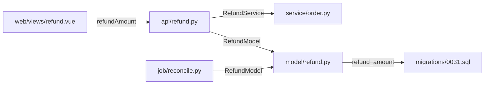

# 产物样例（照此格式写，不要写散文）

以下样例来自真实运行结果，用于对齐格式。

---

## 样例 A：`.devloop/S2-audit.md`（变更审计）

```markdown
# 变更审计 · 2026-10-27

基线：HEAD~1 · 改动 3 个文件 · 整体风险 中(36)

## 1. 漏改清单（P0，必须补齐）

| 计划项（来自 S1） | 现状 | 动作 |
|---|---|---|
| src/api/user.py 新增 delete_user | 已改 | — |
| src/service/order.py 加删除后的订单校验 | 未改 | 补校验分支 |
| docs/api.md 补删除接口说明 | 未改 | 转 S3 |

## 2. 越界改动（需说明理由）

| 文件 | 改动内容 | 是否保留 |
|---|---|---|
| src/common/utils.py | 顺手格式化了整个文件 | 建议拆分独立提交，避免污染 diff |

## 3. 调用方判定

| 调用方 | 引用点 | 判定 | 依据 |
|---|---|---|---|
| src/service/order.py:1 | get_user | 不需要改 | 只读 user.name，签名未变 |
| tests/test_user.py:1 | get_user | 需要改 | 需补 delete_user 用例 |

## 4. 待补测试

| 目标 | 场景 |
|---|---|
| delete_user | 正常删除 / 不存在 id / 重复删除幂等 |

## 5. 复测建议

- 必测：用户删除后订单列表的展示（受 order.py 影响）
- 抽测：用户详情页
- 免测：与本次改动无引用关系的模块
```

---

## 样例 B：`.devloop/S1-impact.md`（需求影响面）

```markdown
# 需求影响面：订单支持部分退款

## 变更意图拆解
| 类型 | 对象 |
|---|---|
| 修改 | 接口 POST /api/refund（金额从全额改为可指定） |
| 新增 | 退款单表字段 refund_amount |
| 修改 | 订单状态机（新增 PARTIAL_REFUNDED） |
| 修改 | 财务对账口径 |

## 影响面矩阵
| 层级 | 对象 | 受影响 | 依据 |
|---|---|---|---|
| 接口 | POST /api/refund | 是 | src/api/refund.py:42 入参校验固定全额 |
| 数据 | refund_order 表 | 是 | 无 refund_amount 字段，需迁移 |
| 下游 | 财务对账任务 | 是 | job/reconcile.py:88 按全额比对 |
| 权限 | 退款权限点 | 否 | 复用现有 refund:write |
| 前端 | 退款弹窗 | 是 | 金额输入框为只读 |

## 改造清单（S2 的验收标准）

| 编号 | 文件:行 | 动作 | 改造理由 | 依据 |
|---|---|---|---|---|
| C1 | src/api/refund.py:42 | 改 | 入参校验写死全额，部分退款会被直接拦掉 | refund.py:42 校验分支 |
| C2 | src/model/refund.py:15 | 改 | 缺 refund_amount 字段，部分金额无处存 | 表结构对照 |
| C3 | migrations/0031.sql | 增 | 不迁移则新字段读出来是空，C2 白改 | C2 的依赖 |
| C4 | src/service/order.py:88 | 改 | 状态机无 PARTIAL_REFUNDED，退款后订单状态错 | 状态枚举缺项 |
| C5 | job/reconcile.py:88 | 改 | 对账按全额比对，部分退款会被判为差异 | 对账口径固定全额 |
| C6 | web/src/views/refund.vue:120 | 改 | 金额输入框只读，用户无法填部分金额 | 前端 readonly |

> 6 个文件，未超 8 个，单表列出。若超过 8 个改为按模块分表。

## 依赖图



**改动顺序**：C2 模型 → C3 迁移 → C1 接口 → C4 状态机 → C5 对账 → C6 前端。
从被依赖最多的一端开始：模型和迁移是根，前端是叶。

## 回归范围
| 级别 | 场景 | 理由 |
|---|---|---|
| 必测 | 全额退款 | 原有主流程，改动直接影响 |
| 必测 | 部分退款 + 再次退款 | 新增边界：累计金额不得超订单额 |
| 必测 | 退款失败后的状态回滚 | 状态机新增分支 |
| 抽测 | 财务日对账 | 口径变化，需跑一次对账 |

## 待确认
- 部分退款后优惠券是否按比例退回？（需产品确认）
```

---

## 样例 C：`.devloop/S5-fix.md`（缺陷修复）

```markdown
# 缺陷定位：订单列表偶发 500

## 现象
- 报错：`AttributeError: 'NoneType' object has no attribute 'name'`
- 堆栈：app/service/order.py:118 → app/api/order.py:56
- 频率：约 1/2000，集中在凌晨批处理时段

## 根因
`get_user()` 在用户已注销时返回 None（src/api/user.py:23），
order.py:118 直接取 `.name` 未判空。批处理时段并发删除用户触发。

分类：数据（软删除用户）+ 逻辑（缺判空）

## 证据链
- 复现脚本：先软删用户再查订单，稳定复现（tests/repro_500.py）
- 日志：失败请求的 user_id 均对应 deleted_at 非空记录

## 修复
| 位置 | 改动 |
|---|---|
| src/service/order.py:118 | 判空，返回「用户已注销」占位 |
| src/api/user.py:23 | 文档注明可能返回 None（或改为抛业务异常） |

## 回归
- 必测：已注销用户的订单列表、正常用户订单列表
- 新增单测：tests/test_order.py::test_order_list_with_deleted_user

## 遗留风险
其他 7 处调用 get_user 的地方同样未判空，建议统一改为 Optional 并加静态检查
```

---

## 样例 D：`.devloop/S3-docs.md`（文档三分类 + 新建方案）

```markdown
# 文档同步 · 2026-11-03

## 分类结果

| 文档 | 分类 | 判定依据 |
|---|---|---|
| docs/api/refund.md | 更新 | 存在，但接口签名仍是全额退款 |
| docs/api/order.md | 不改 | 仅提到 refund 模块名，语义未变 |
| docs/db/refund_order.md | **新建** | 表结构变了，仓库里没有任何字段说明 |
| CHANGELOG.md | 更新 | 需补一条 1.4.0 记录 |

## 更新：docs/api/refund.md:34

原文：
> POST /api/refund  body: {order_id}

新文：
> POST /api/refund  body: {order_id, amount}
> - amount：本次退款金额，必填，0 < amount ≤ 剩余可退金额
> - 不传视为全额退款（兼容旧客户端）

## 新建：docs/db/refund_order.md

- **定位**：给后端与数据同学看的字段说明
- **骨架**：
  1. 表用途（一句话）
  2. 字段表：字段 / 类型 / 是否必填 / 含义 / 备注
  3. 状态取值
  4. 变更记录
- **内容要点**：
  - 字段表含 `refund_amount decimal(12,2) not null default 0`，注明"仅部分退款场景非零"
  - 状态取值列出 PARTIAL_REFUNDED
  - 变更记录第一条：2026-11-03 新增 refund_amount
- **锚点**（供 drift 检测）：`refund_amount`、`src/model/refund.py`、`PARTIAL_REFUNDED`

是否创建这份文档？

## 文档基线（下轮 S2 后复核）

| 文档 | 关键锚点 | 本次时间 |
|---|---|---|
| docs/api/refund.md | `/api/refund`、`amount` | 2026-11-03 |
| docs/db/refund_order.md | `refund_amount`、`PARTIAL_REFUNDED` | 2026-11-03 |
```

---

## 样例 E：偏离清单与敏感文件记录

```markdown
## 偏离记录（附在 S2-audit.md 末尾）

| 编号 | 清单原计划 | 实际 | 原因 | 用户决定 |
|---|---|---|---|---|
| C3 | 迁移加字段，默认 0 | 需额外回填脏数据 | 线上已有 NULL 值，默认值补不上 | 同意，拆出 C3.1 |
| C4 | 状态机加 PARTIAL_REFUNDED | 未做 | 等产品确认能否复用 REFUNDED | 先跳过 |

## 授权记录（改动敏感文件时）

| 时间 | 文件 | 级别 | 用户原话 | 变更摘要 |
|---|---|---|---|---|
| 2026-11-03 10:12 | migrations/0031.sql | 高危 | "可以，按这个改" | 加字段 + 回填 |
```

---

## 格式红线

- 每个结论后面跟 `文件:行`
- 用表格，不用"首先/其次/总之"
- 没有证据的判断标注「疑似」
- 没跑的命令标 `NOT RUN` 并附下一条可执行命令
- 风险等级只用 高/中/低 与 P0/P1/P2，不自创分级
- 改造清单缺「改造理由」或「依据」列 → 不合格，重写
- 超过 8 个文件的清单平铺一页 → 不合格，改分组或分层 + 图谱
- 跳过任何清单项却没在 S2 里标 SKIPPED → 不合格
- 改了敏感文件却没有授权记录 → 不合格
