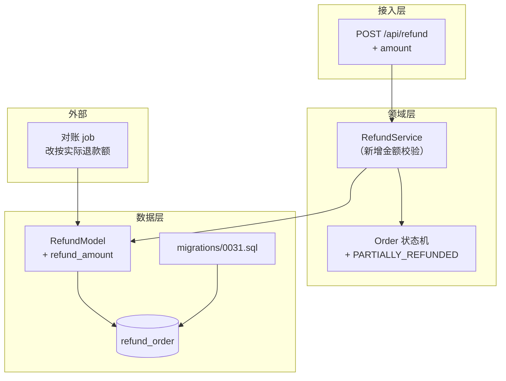
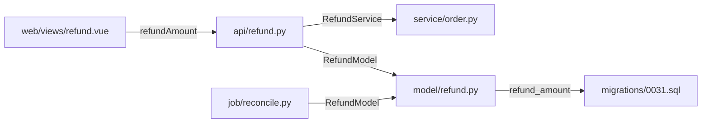

# 产物样例（照此格式写，不要写散文）

以下样例来自真实运行结果，用于对齐格式。

---

## 样例 A：`.devloop/S3-变更审计.md`（变更审计）

```markdown
# 变更审计 · 2026-10-27

基线：HEAD~1 · 改动 3 个文件 · 整体风险 中(36)

## 1. 漏改清单（P0，必须补齐）

| 计划项（来自 S1） | 现状 | 动作 |
|---|---|---|
| src/api/user.py 新增 delete_user | 已改 | — |
| src/service/order.py 加删除后的订单校验 | 未改 | 补校验分支 |
| docs/api.md 补删除接口说明 | 未改 | 转 S4 |

## 2. 越界改动（需说明理由）

| 文件 | 改动内容 | 是否保留 |
|---|---|---|
| src/common/utils.py | 顺手格式化了整个文件 | 建议拆分独立提交，避免污染 diff |

## 3. 调用方判定

| 调用方 | 引用点 | 判定 | 依据 |
|---|---|---|---|
| src/service/order.py:1 | get_user | 不需要改 | 只读 user.name，签名未变 |
| tests/test_user.py:1 | get_user | 需要改 | 需补 delete_user 用例 |

## 4. 待补测试

| 目标 | 场景 |
|---|---|
| delete_user | 正常删除 / 不存在 id / 重复删除幂等 |

## 5. 复测建议

- 必测：用户删除后订单列表的展示（受 order.py 影响）
- 抽测：用户详情页
- 免测：与本次改动无引用关系的模块
```

---

## 样例 B：`.devloop/S1-影响面与方案.md`（技术方案 + 影响面）

**方案在前，清单在后。** 只写清单不写方案，`gate` 会直接拒绝登记。

````markdown
# 需求影响面与技术方案：订单支持部分退款

## 一、需求理解与验收标准

一句话：退款金额从"全额"改为"可指定，且累计不超过订单金额"。

可判定的验收条件：

- 部分退款 30（订单 100）→ 状态 `PARTIALLY_REFUNDED`，`refunded_amount` = 30
- 已退 80 再退 30 → 返回 `REFUND_EXCEED`，金额与状态均不变
- 全额退款 → 状态 `REFUNDED`，对账口径与退款额一致

## 二、技术路线

| 路线 | 做法 | 优点 | 代价 / 风险 | 结论 |
|---|---|---|---|---|
| A 接口层校验 | controller 里比对订单额与已退额 | 改动最小，一天能上 | 校验散落，多入口必然不一致；对账仍按全额 | 否决 |
| B 收敛到订单聚合 | 订单持有 `refunded_amount`，`check_refundable()` 统一校验 | 口径唯一，对账与状态机共用同一来源 | 需要加字段与迁移，改动面 6 个文件 | **采纳** |

**选型理由**：退款金额是账务口径，A 方案下接口、对账、后台补偿三个入口各算一次，迟早不一致。
B 多一点迁移成本，换来单一事实源。

**未决**：并发退款是否需要行锁？待确认（压测 + 现有事务边界评估后定）。

## 三、实现流程

| 步 | 动作 | 依赖 | 验证方式 |
|---|---|---|---|
| 1 | 迁移 `0031.sql` 增加 `refund_amount` 默认 0 | — | 开发库执行 + 回滚各一次 |
| 2 | `RefundModel` 加字段与 `check_refundable()` | 1 | 单测覆盖超额 / 等额 / 零值 |
| 3 | `create_refund` 入参加 `amount` 并调用校验 | 2 | 接口测三类金额 |
| 4 | 订单状态机加 `PARTIALLY_REFUNDED` | 3 | 状态流转用例 |
| 5 | 对账 job 改按实际退款额 | 3 | 用历史一天数据比对 |
| 6 | 前端金额可编辑 + 校验 | 3 | 手工测输入边界 |

**顺序理由**：2 依赖 1 的字段；3 是 4/5/6 的共同前置。前端放最后，避免接口未定就先改 UI。

## 四、架构图



改动落点：接入层加入参、领域层加校验与状态、数据层加字段、对账改口径。
图里每个框都能在改造清单里找到对应文件。

## 五、静态盲区

`blind` 报出的动态调用，逐条给结论。脚本看不见 = 影响面在这里不成立，必须人工补：

| 位置 | 类别 | 结论 |
|---|---|---|
| `src/service/refund.py:88` | 反射 | `handler = getattr(module, action)` 按 action 取处理器；本次新增 `partial_refund` 需在 action 白名单里加一项，否则路由不到 |
| `src/config/routes.py:14` | 动态路由 | 路径由 `PREFIX + path` 拼装，本次接口路径不变，无需改 |
| 外部 | 跨服务 | 退款事件由 order-service 消费，字段 `refund_amount` 新增后需通知对方；不在本仓库，无法自动检测 |

## 六、实现约束

S3 按这几条核，写清就照做，含糊的要先问：

| 项 | 约束 |
|---|---|
| 命名与分层 | 校验放 `Order.check_refundable()`，不在 controller 里写业务判断 |
| 错误处理 | 超额抛 `BusinessError(REFUND_EXCEED)`，不吞异常；DB 异常照常上抛 |
| 日志 | 用 `logger.info`，只记 order_id 与金额，不记用户信息 |
| 测试 | 新增 3 个用例：部分退款、超额被拒、全额退款；跑 `pytest -q tests/test_refund.py` |
| 兼容 | 存量订单 `refunded_amount` 默认 0，迁移需可回滚 |

## 七、变更意图拆解

| 类型 | 对象 |
|---|---|
| 修改 | 接口 POST /api/refund（金额从全额改为可指定） |
| 新增 | 退款单表字段 refund_amount |
| 修改 | 订单状态机（新增 PARTIAL_REFUNDED） |
| 修改 | 财务对账口径 |

## 八、影响面矩阵

| 层级 | 对象 | 受影响 | 依据 |
|---|---|---|---|
| 接口 | POST /api/refund | 是 | src/api/refund.py:42 入参校验固定全额 |
| 数据 | refund_order 表 | 是 | 无 refund_amount 字段，需迁移 |
| 下游 | 财务对账任务 | 是 | job/reconcile.py:88 按全额比对 |
| 权限 | 退款权限点 | 否 | 复用现有 refund:write |
| 前端 | 退款弹窗 | 是 | 金额输入框为只读 |

## 九、改造清单（S3 的验收标准）

| 编号 | 文件:行 | 动作 | 改造理由 | 依据 |
|---|---|---|---|---|
| C1 | src/api/refund.py:42 | 改 | 入参校验写死全额，部分退款会被直接拦掉 | refund.py:42 校验分支 |
| C2 | src/model/refund.py:15 | 改 | 缺 refund_amount 字段，部分金额无处存 | 表结构对照 |
| C3 | migrations/0031.sql | 增 | 不迁移则新字段读出来是空，C2 白改 | C2 的依赖 |
| C4 | src/service/order.py:88 | 改 | 状态机无 PARTIAL_REFUNDED，退款后订单状态错 | 状态枚举缺项 |
| C5 | job/reconcile.py:88 | 改 | 对账按全额比对，部分退款会被判为差异 | 对账口径固定全额 |
| C6 | web/src/views/refund.vue:120 | 改 | 金额输入框只读，用户无法填部分金额 | 前端 readonly |

> 6 个文件，未超 8 个，单表列出。若超过 8 个改为按模块分表。

## 依赖图



**改动顺序**：C2 模型 → C3 迁移 → C1 接口 → C4 状态机 → C5 对账 → C6 前端。
从被依赖最多的一端开始：模型和迁移是根，前端是叶。

## 回归范围
| 级别 | 场景 | 理由 |
|---|---|---|
| 必测 | 全额退款 | 原有主流程，改动直接影响 |
| 必测 | 部分退款 + 再次退款 | 新增边界：累计金额不得超订单额 |
| 必测 | 退款失败后的状态回滚 | 状态机新增分支 |
| 抽测 | 财务日对账 | 口径变化，需跑一次对账 |

## 待确认
- 部分退款后优惠券是否按比例退回？（需产品确认）
````

---

## 样例 C：`.devloop/S6-缺陷定位.md`（缺陷修复）

```markdown
# 缺陷定位：订单列表偶发 500

## 现象
- 报错：`AttributeError: 'NoneType' object has no attribute 'name'`
- 堆栈：app/service/order.py:118 → app/api/order.py:56
- 频率：约 1/2000，集中在凌晨批处理时段

## 根因
`get_user()` 在用户已注销时返回 None（src/api/user.py:23），
order.py:118 直接取 `.name` 未判空。批处理时段并发删除用户触发。

分类：数据（软删除用户）+ 逻辑（缺判空）

## 证据链
- 复现脚本：先软删用户再查订单，稳定复现（tests/repro_500.py）
- 日志：失败请求的 user_id 均对应 deleted_at 非空记录

## 修复
| 位置 | 改动 |
|---|---|
| src/service/order.py:118 | 判空，返回「用户已注销」占位 |
| src/api/user.py:23 | 文档注明可能返回 None（或改为抛业务异常） |

## 回归
- 必测：已注销用户的订单列表、正常用户订单列表
- 新增单测：tests/test_order.py::test_order_list_with_deleted_user

## 遗留风险
其他 7 处调用 get_user 的地方同样未判空，建议统一改为 Optional 并加静态检查
```

---

## 样例 D：`.devloop/S4-文档同步.md`（文档三分类 + 新建方案）

```markdown
# 文档同步 · 2026-11-03

## 分类结果

| 文档 | 分类 | 判定依据 |
|---|---|---|
| docs/api/refund.md | 更新 | 存在，但接口签名仍是全额退款 |
| docs/api/order.md | 不改 | 仅提到 refund 模块名，语义未变 |
| docs/db/refund_order.md | **新建** | 表结构变了，仓库里没有任何字段说明 |
| CHANGELOG.md | 更新 | 需补一条 1.4.0 记录 |

## 更新：docs/api/refund.md:34

原文：
> POST /api/refund  body: {order_id}

新文：
> POST /api/refund  body: {order_id, amount}
> - amount：本次退款金额，必填，0 < amount ≤ 剩余可退金额
> - 不传视为全额退款（兼容旧客户端）

## 新建：docs/db/refund_order.md

- **定位**：给后端与数据同学看的字段说明
- **骨架**：
  1. 表用途（一句话）
  2. 字段表：字段 / 类型 / 是否必填 / 含义 / 备注
  3. 状态取值
  4. 变更记录
- **内容要点**：
  - 字段表含 `refund_amount decimal(12,2) not null default 0`，注明"仅部分退款场景非零"
  - 状态取值列出 PARTIAL_REFUNDED
  - 变更记录第一条：2026-11-03 新增 refund_amount
- **锚点**（供 drift 检测）：`refund_amount`、`src/model/refund.py`、`PARTIAL_REFUNDED`

是否创建这份文档？

## 文档基线（下轮 S3 后复核）

| 文档 | 关键锚点 | 本次时间 |
|---|---|---|
| docs/api/refund.md | `/api/refund`、`amount` | 2026-11-03 |
| docs/db/refund_order.md | `refund_amount`、`PARTIAL_REFUNDED` | 2026-11-03 |
```

---

## 样例 E：偏离清单与敏感文件记录

```markdown
## 偏离记录（附在 S3-变更审计.md 末尾）

| 编号 | 清单原计划 | 实际 | 原因 | 用户决定 |
|---|---|---|---|---|
| C3 | 迁移加字段，默认 0 | 需额外回填脏数据 | 线上已有 NULL 值，默认值补不上 | 同意，拆出 C3.1 |
| C4 | 状态机加 PARTIAL_REFUNDED | 未做 | 等产品确认能否复用 REFUNDED | 先跳过 |

## 授权记录（改动敏感文件时）

| 时间 | 文件 | 级别 | 用户原话 | 变更摘要 |
|---|---|---|---|---|
| 2026-11-03 10:12 | migrations/0031.sql | 高危 | "可以，按这个改" | 加字段 + 回填 |
```

---

## 样例 F：`.devloop/验证报告.md`（验证 + 自测清单）

```markdown
# 验证报告

- 命令：`pytest -q`
- 退出码：0
- 耗时：18.4s
- 结论：**通过**
- 用例：通过 42 / 失败 0 / 跳过 3

## 建议用户自测清单

| ✓ | 场景 | 怎么测 | 涉及文件 |
|---|---|---|---|
| □ | 接口调用 | 正常入参 / 缺参 / 越权 / 不存在的 id | `src/api/refund.py` |
| □ | 数据库迁移 | 开发库执行一遍，再回滚一次，确认可重复执行 | `migrations/0031.sql` |
| □ | 页面操作 | 打开退款弹窗，填部分金额，看校验与提示 | `web/views/refund.vue` |
```

交给用户时必须带上这段话，不能只说"测试通过"：

> 自动化覆盖了 42 个用例，但边界和交互还得你手工过一遍。

## 样例 G：`.devloop/S7-提交清单.md`（提交清单）

```markdown
# 提交清单（待确认）

- 文件数：12（+340 / -86）
- 分支：feat/partial-refund
- 当前 HEAD：a1b2c3d

## 提交内容

| 状态 | 文件 | 增/删 |
|---|---|---|
| | **migrations**（1） | |
| A | `migrations/0031_add_refund_amount.sql` | +18/-0 |
| | **src**（5） | |
| M | `src/api/refund.py` | +64/-22 |
| M | `src/model/refund.py` | +12/-3 |
| | **docs**（3） | |
| M | `docs/api/refund.md` | +26/-8 |
| A | `docs/db/refund_order.md` | +58/-0 |

## 敏感文件提醒

| 级别 | 文件 |
|---|---|
| 高危 | `migrations/0031_add_refund_amount.sql` |

## 建议提交信息

​```
feat(refund): 支持部分退款

- 退款接口接受 amount，校验不超过剩余可退金额
- 新增 refund_order.refund_amount 字段与迁移
- 订单状态机新增 PARTIAL_REFUNDED
​```

## 是否重大改动

**是**：涉及高危文件：migrations/0031_add_refund_amount.sql；增减 426 行（≥300）
建议打标签：`v1.4.0`

## 确认项

- [ ] 文件清单无误，没有遗漏或多带
- [ ] 提交信息描述准确
- [ ] 验证已通过（`.devloop/验证报告.md`）
- [ ] 敏感文件已获授权
- [ ] 重大改动已打标签
```

## 样例 H：给用户看的提交确认话术

```
准备提交 12 个文件（+340 / -86）：
- src/（5 个）：refund.py、order.py、refund 模型…
- migrations/（1 个）：0031_add_refund_amount.sql ← 高危，已获授权
- docs/（3 个）：api/refund.md、db/refund_order.md…

建议信息：feat(refund): 支持部分退款
重大改动：是（涉及迁移 + 426 行）
建议标签：v1.4.0

清单和提交信息是否 OK？确认后我提交。
```

---

## 格式红线

- 每个结论后面跟 `文件:行`
- 用表格，不用"首先/其次/总之"
- 没有证据的判断标注「疑似」
- 没跑的命令标 `NOT RUN` 并附下一条可执行命令
- 风险等级只用 高/中/低 与 P0/P1/P2，不自创分级
- 改造清单缺「改造理由」或「依据」列 → 不合格，重写
- 超过 8 个文件的清单平铺一页 → 不合格，改分组或分层 + 图谱
- 跳过任何清单项却没在 S3 里标 SKIPPED → 不合格
- 改了敏感文件却没有授权记录 → 不合格

---

## 各阶段报告校验（`gate` 按这个判定）

只写标题不算数，得真有内容：

| 阶段 | 报告里必须有的小节 | 内容下限 |
|---|---|---|
| S1 | 技术路线 / 实现流程 / 架构图 / 改造清单 / 静态盲区 / 实现约束 | 路线 ≥2 条；流程 ≥1 步；架构图必须有 ` ```mermaid ` 块；清单 ≥1 条；盲区与实现约束小节非空（「无」也算） |
| S3 | 漏改、越界、实现质量 | 三节都要有内容（「无」也算） |
| S4 | 文档 / 新建 / 更新 / 不改 | 至少 1 条判定 |
| S5 | 健康 / 问题 / P0 / P1 | 小节非空（「未发现问题」也算） |
| S6 | 根因、修复 | 两节都要有内容 |

标题名不匹配 = 找不到那一节 = 判「小节为空」并拒绝登记。不合格时会逐条列出差什么：

```text
S1 报告不达要求，不予登记：
  - 技术路线（只有 1 条，至少 2 条）
  - 架构图（缺少 mermaid 代码块）
```

> 卡这么细的理由：只有标题的报告，用户点「同意」时其实什么也没看到。
> 门禁要保证「用户看到的东西一定存在」，而不是「文件存在」。

---

## S1 贴给用户的话术

方案和清单一起给，让用户能做选择，而不是只能点头：

````text
方案给你看一下，两条路线：

| 路线 | 做法 | 代价 | 结论 |
|---|---|---|---|
| A 接口层校验 | 改动小，1 天 | 多入口不一致 | 备选 |
| B 收敛到订单聚合 | 需加字段 + 迁移 | 口径唯一 | 采纳 |

实现流程 5 步（迁移 → 模型校验 → 接口透传 → 状态机 → 对账改口径），详见报告。

架构图、改造清单都在页面里：4 个文件，其中 1 个是新迁移，需要你单独确认。

静态盲区 2 处：`dispatch()` 里按名字动态取 handler、`ROUTE` 由配置拼装，
这两个位置脚本看不见调用方，我按人工核了一遍，结论写在报告里。

实现约束按团队规范定了命名、错误码、日志三项，S3 会逐条核。

选 B 可以吗？确认后我开始改；要换路线或缩范围直接说。
````

要点：**先给方案对比，再给清单，最后给风险与约束**。不要一上来就贴文件列表——
用户没法判断「该不该这么改」，只能判断「改得全不全」。
